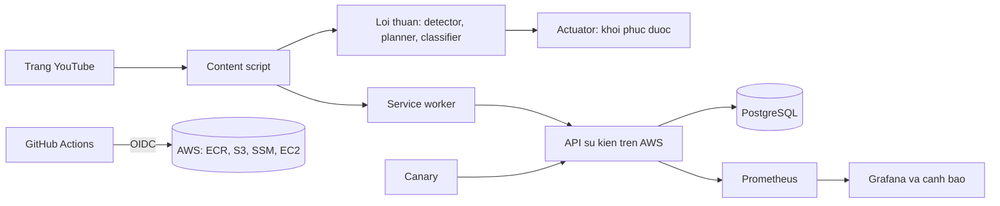

# AdFilter — Tiện ích Lọc Quảng cáo YouTube (Manifest V3) & Hệ thống Quan sát Đám mây

[](https://github.com/Datkewww123/Adfilter/actions/workflows/verify.yml)
[](LICENSE)
[](CHANGELOG.md)

> **Mô tả & Phạm vi Dự án:** AdFilter là tiện ích trình duyệt đa nền tảng (**Chromium & Firefox Manifest V3**) viết bằng TypeScript với kiến trúc **Lõi Quyết định Thuần (Pure Core)**, kết hợp hệ thống **Observability (Fastify, PostgreSQL, Prometheus, Grafana, Canary)** và hạ tầng **AWS Terraform IaC & OIDC Continuous Deployment**. Dự án phục vụ mục đích học tập, nghiên cứu kỹ thuật phần mềm và thử nghiệm cá nhân trên tài khoản phụ; tiện ích **không** được phát hành lên Chrome Web Store hay Mozilla Add-ons.

---

## 1. Kiến trúc Tổng thể Hệ thống

Chi tiết kiến trúc, ranh giới tin cậy và các đánh đổi kỹ thuật được mô tả đầy đủ tại **[docs/ARCHITECTURE.md](docs/ARCHITECTURE.md)**.



### Các Bản ghi Quyết định Kiến trúc (Architecture Decision Records — ADRs):
- **[ADR-0001](docs/decisions/0001-pure-core.md):** Tách Lõi Quyết định Thuần (`src/core/`) khỏi DOM và Chrome API.
- **[ADR-0002](docs/decisions/0002-dry-run-default.md):** Chế độ Chạy thử (`dryRun`) làm công tắc an toàn hạng nhất.
- **[ADR-0003](docs/decisions/0003-circuit-breaker-and-safe-degradation.md):** Bộ Ngắt mạch (`Circuit Breaker`) và Hạ cấp An toàn khi gặp cảnh báo trang.
- **[ADR-0004](docs/decisions/0004-opt-in-telemetry-whitelist.md):** Telemetry Tùy chọn (`Opt-in`) và Lọc Danh sách Trắng Kép.
- **[ADR-0005](docs/decisions/0005-ssm-not-ssh.md):** Quản trị Máy chủ qua AWS SSM Session Manager thay vì Mở Cổng SSH (`0 inbound rules`).
- **[ADR-0006](docs/decisions/0006-oidc-not-keys.md):** Xác thực GitHub Actions với AWS bằng OIDC thay vì Khóa Dài hạn.
- **[ADR-0007](docs/decisions/0007-release-directories.md):** Mỗi lần Triển khai một Thư mục Phát hành (`releases/<TAG>`) để Quay lui Nguyên tử cả Ảnh lẫn Cấu hình.

---

## 2. Bảng Số liệu Kỹ thuật Chính (Key Engineering Metrics)

Chi tiết phân tích kỹ thuật và nguồn đo lường xem tại **[docs/CASE-STUDY.md](docs/CASE-STUDY.md)**.

| Chỉ số | Giá trị đạt được | Nguồn bằng chứng |
| :--- | :---: | :--- |
| **Precision & Recall trên tập Fixtures (`n = 17`)** | **Precision = 100.0% (`1.000`)**<br>**Recall = 100.0% (`1.000`)** (`0 FP`, `0 FN`) | [`docs/notes/eval-baseline.md`](docs/notes/eval-baseline.md) & `pnpm eval` |
| **Phiên dùng thực tế (`n = 53` quảng cáo)** | **Xác minh đạt: 96.2% (51/53)**<br>**Video chính bị kẹt: `0` (0.0%)** | [`docs/notes/week9-metrics.md`](docs/notes/week9-metrics.md) |
| **Quy mô Kiểm thử Tự động** | **34 Unit Test suites (`253 tests`)**<br>**4 Server Test suites (`12 tests`)**<br>**7 kịch bản Playwright E2E (`35/35` stress runs)** | [`docs/notes/test-coverage.md`](docs/notes/test-coverage.md) & [`.github/workflows/verify.yml`](.github/workflows/verify.yml) |
| **Thời gian phát hiện sự cố (MTTD — 2 Chaos Drills)** | **Drill 01 (Hỏng DOM): `~45 giây`**<br>**Drill 02 (Ngắt mạch hàng loạt): `~40 giây`** | [`docs/notes/chaos-drill-01.md`](docs/notes/chaos-drill-01.md) & [`docs/notes/chaos-drill-02.md`](docs/notes/chaos-drill-02.md) |
| **Thời gian Quay lui ( Tự động & Thủ công )** | **`~45 – 60 giây`** (cả Docker image lẫn cấu hình) | [`docs/notes/deploy-runbook.md`](docs/notes/deploy-runbook.md) |
| **Thời gian Khôi phục Hạ tầng từ Số 0 (RTO)** | **`6 phút 30 giây` (6.5 phút)** | [`docs/notes/rebuild-from-zero.md`](docs/notes/rebuild-from-zero.md) |

---

## 3. Hướng dẫn Cài đặt & Sử dụng An toàn

### Cài đặt trên Google Chrome / Chromium:
1. Tải gói `adfilter-chromium-v1.0.0.zip` và `SHA256SUMS.txt` từ trang **[Releases](https://github.com/Datkewww123/Adfilter/releases)** (hoặc chạy `pnpm build` để tạo thư mục `dist/chromium/`).
2. Kiểm tra tính toàn vẹn SHA-256:
   ```powershell
   Get-FileHash adfilter-chromium-v1.0.0.zip -Algorithm SHA256
   ```
3. Mở `chrome://extensions/`, bật **Developer mode**, bấm **Load unpacked** và chọn thư mục đã giải nén (`dist/chromium/`).

### Cài đặt trên Mozilla Firefox:
- Chạy `pnpm build:firefox` để đóng gói vào `dist/firefox/` và xem hướng dẫn nạp tiện ích tại [`docs/notes/firefox-install.md`](docs/notes/firefox-install.md).

### Cơ chế An toàn khi Sử dụng:
- **Chế độ Chạy thử (`Dry-run`):** Có thể bật ngay trong Popup để quan sát nhật ký nhận diện mà không can thiệp vào trình phát.
- **Khôi phục Tự động:** Luôn khôi phục 100% âm lượng và tốc độ phát ban đầu của người dùng ngay khi quảng cáo kết thúc.
- **Phím tắt Khẩn cấp (`Alt + Shift + K`):** Tắt/bật tức thời tiện ích trên tab hiện tại và trả trình phát về trạng thái gốc.
- **Bộ Ngắt mạch (`Circuit Breaker`):** Tự động ngừng can thiệp nếu phát hiện cảnh báo chống chặn quảng cáo từ trang.

---

## 4. Lệnh Dành cho Nhà Phát triển

```bash
# Cài đặt toàn bộ phụ thuộc
pnpm install

# Chạy một lệnh kiểm tra tổng hợp toàn bộ dự án (Lint + Typecheck + 253 Unit Tests + Quality Gate Eval + Multi-target Build)
pnpm verify:all

# Đóng gói bản Dev và chạy 7 kịch bản kiểm thử đầu cuối Playwright E2E
pnpm build:dev
pnpm e2e

# Chạy kiểm tra kiểu và bộ test của Telemetry & Canary API Server
pnpm --dir server typecheck
pnpm --dir server test
```

---

## 5. Tài liệu Vận hành, Nghiệm thu & Trình diễn

- **Kiến trúc hệ thống:** **[docs/ARCHITECTURE.md](docs/ARCHITECTURE.md)**
- **Sổ tay xử lý sự cố tổng hợp & Xoay mật khẩu:** **[docs/RUNBOOK.md](docs/RUNBOOK.md)**
- **Sổ tay triển khai CD & Quay lui trên AWS:** **[docs/notes/deploy-runbook.md](docs/notes/deploy-runbook.md)**
- **Tiêu chuẩn hoàn thành & Bằng chứng nghiệm thu (DoD):** **[docs/DONE.md](docs/DONE.md)**
- **Nghiên cứu tình huống kỹ thuật (Case Study):** **[docs/CASE-STUDY.md](docs/CASE-STUDY.md)**
- **Kịch bản trình diễn 3 phút (Demo Script):** **[docs/DEMO.md](docs/DEMO.md)**
- **Cẩm nang chuẩn bị phỏng vấn & CV:** **[docs/notes/interview-prep.md](docs/notes/interview-prep.md)**

---

## 6. Trạng thái Dự án (Project Status)

- **Phiên bản hiện tại:** **`v1.0.0`** (Phát hành ngày `2026-11-06`).
- **Trạng thái chương trình 20 tuần:** **Đã hoàn thành trọn vẹn 20/20 tuần** (từ Phase 0 đến Phase 9).
- **Hướng phát triển tiếp theo (Tùy chọn):**
  1. Thiết lập sao lưu tự động PostgreSQL (`pg_dump`) lên S3 theo lịch định kỳ.
  2. Tích hợp chạy Playwright E2E tự động cho bản build Firefox trên GitHub Actions.
  3. Phân tích phát hiện bất thường thống kê trên dữ liệu telemetry dài hạn.

---

## 7. Giấy phép Mã nguồn

Dự án được phân phối dưới giấy phép mã nguồn mở **MIT License**. Xem chi tiết tại file [LICENSE](LICENSE).
