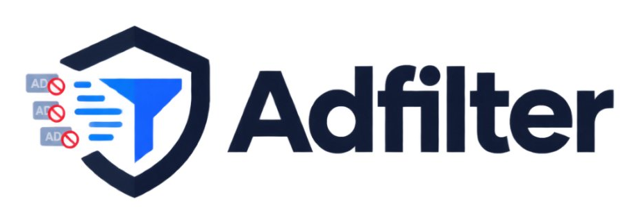
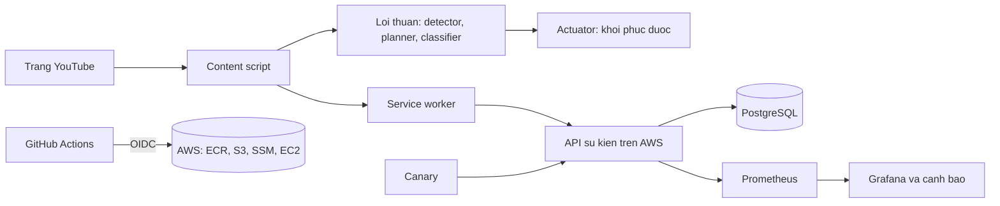

<p align="center">
  
</p>

# AdFilter v3.1.6 — Universal AdFilter (Manifest V3) & Cloud Observability

[](https://github.com/Datkewww123/Adfilter/actions/workflows/verify.yml)
[](LICENSE)
[](CHANGELOG.md)

**AdFilter** là tiện ích (extension) chặn quảng cáo cho trình duyệt **Chrome, Cốc Cốc, Edge, Brave**: chặn quảng cáo YouTube, popup/tab quảng cáo tự bật và banner cờ bạc trên web xem phim, web đọc truyện.

---

## 📥 Hướng dẫn Tải về & Cài đặt Chi tiết (từ A → Z cho người không biết lập trình)

> Bạn **không cần cài phần mềm lập trình** và **không cần biết code**. Chỉ cần làm đúng 4 bước dưới đây (khoảng 2 phút).

### A. Cài đặt trên Chrome, Cốc Cốc, Microsoft Edge, Brave

#### Bước 1: Tải đúng file gói tiện ích về máy
1. Mở trang phát hành chính thức: **👉 [https://github.com/Datkewww123/Adfilter/releases/latest](https://github.com/Datkewww123/Adfilter/releases/latest)**
2. Kéo xuống cuối bản ghi chú, tìm mục **Assets (Tệp đính kèm)**.
3. Bấm trực tiếp vào dòng **`adfilter-chromium-v3.1.6.zip`** để tải về máy:

| Tên file trong mục Assets | Dành cho trình duyệt nào? | Cần tải không? |
| :--- | :--- | :---: |
| **`adfilter-chromium-v3.1.6.zip`** | **Google Chrome, Cốc Cốc, Microsoft Edge, Brave, Opera** | ✅ **TẢI FILE NÀY** |
| `adfilter-firefox-v3.1.6.zip` | Mozilla Firefox | 🦊 Chỉ tải nếu dùng Firefox |
| `SHA256SUMS.txt` | File kiểm tra mã băm bảo mật (dành cho kỹ thuật) | Không bắt buộc |
| `Source code (zip)` / `Source code (tar.gz)` | Mã nguồn lập trình chưa biên dịch | ❌ **KHÔNG TẢI** |

> [!WARNING]
> **Tuyệt đối KHÔNG** bấm nút màu xanh **`<> Code` → `Download ZIP`** ở trang chủ GitHub và **KHÔNG** tải `Source code (zip)`. Đó là mã nguồn thô chưa đóng gói, khi nạp vào Chrome sẽ báo lỗi không dùng được. File đúng bắt buộc phải có chữ **`adfilter-chromium`** trong tên.

#### Bước 2: Giải nén file vào một thư mục cố định
1. Mở thư mục **Downloads (Tải xuống)** trên máy tính, tìm file `adfilter-chromium-v3.1.6.zip`.
2. **Đặt ở nơi cố định trước khi cài:** Nên copy file `.zip` này sang một thư mục riêng mà bạn không bao giờ xóa (ví dụ `D:\AdFilter\` hoặc `Documents\AdFilter\`), vì sau khi cài trình duyệt sẽ đọc trực tiếp từ thư mục giải nén.
3. **Giải nén:**
   - **Trên Windows:** Nhấp **chuột phải** vào `adfilter-chromium-v3.1.6.zip` → chọn **"Extract All..." (Giải nén tất cả)** → bấm **Extract** *(hoặc nếu dùng WinRAR / 7-Zip thì chọn `Extract to "adfilter-chromium-v3.1.6\"`)*.
   - **Trên macOS:** Nhấp đúp chuột trái vào file `adfilter-chromium-v3.1.6.zip` để tự giải nén ra thư mục cùng tên.
4. **Kiểm tra thư mục sau khi giải nén:** Mở thư mục `adfilter-chromium-v3.1.6` ra, bạn phải thấy ngay file **`manifest.json`** nằm cùng cấp với `background.js`, `content.js`, `defuser.js` và thư mục `rules`.
   *(Lưu ý: Nếu mở `adfilter-chromium-v3.1.6` ra mà lại thấy thêm một thư mục `adfilter-chromium-v3.1.6` nữa bên trong, thì ở Bước 3 bạn nhớ chọn **thư mục con bên trong cùng** nơi chứa trực tiếp file `manifest.json`).*

> [!IMPORTANT]
> **Không xóa, không đổi tên và không di chuyển** thư mục đã giải nén sau khi cài xong. Nếu xóa thư mục này, tiện ích sẽ bị mất khỏi trình duyệt ở lần mở máy tiếp theo.

#### Bước 3: Nạp tiện ích vào trình duyệt (`Load unpacked`)
1. Mở trình duyệt của bạn, copy dòng địa chỉ tương ứng bên dưới dán vào thanh địa chỉ rồi nhấn **Enter**:
   - **Google Chrome:** `chrome://extensions`
   - **Cốc Cốc:** `coccoc://extensions`
   - **Microsoft Edge:** `edge://extensions`
   - **Brave:** `brave://extensions`
2. Bật công tắc **"Developer mode" (Chế độ dành cho nhà phát triển)**:
   - Trên **Chrome / Cốc Cốc / Brave**: công tắc nằm ở **góc trên cùng bên phải**.
   - Trên **Microsoft Edge**: công tắc nằm ở **thanh menu bên trái** (hoặc góc trên phải tùy phiên bản).
3. Sau khi bật, một hàng nút mới sẽ hiện ra ở góc trên bên trái. Bấm vào nút **"Load unpacked" (Tải tiện ích đã giải nén)**.
4. Trong cửa sổ chọn thư mục: tìm và bấm chọn **thư mục `adfilter-chromium-v3.1.6`** (thư mục có chứa file `manifest.json` ở Bước 2) → bấm **Select Folder (Chọn thư mục)**.
5. ✅ Hoàn tất! Thẻ **AdFilter `3.1.6`** sẽ xuất hiện trong danh sách tiện ích với công tắc đang **Bật**.

#### Bước 4: Ghim biểu tượng ra thanh công cụ & làm mới tab
1. Bấm vào biểu tượng **mảnh ghép 🧩 (Extensions)** ở góc phải thanh địa chỉ trình duyệt.
2. Tìm **AdFilter** và bấm biểu tượng **chiếc ghim 📌** để nút **AdFilter** luôn hiện trên thanh công cụ.
3. Quay lại các tab YouTube, web xem phim hoặc web đọc truyện đang mở sẵn và nhấn **`F5` (Tải lại trang)** để tiện ích bắt đầu bảo vệ ngay lập tức.

### B. Cài đặt trên Mozilla Firefox
- Tải file **`adfilter-firefox-v3.1.6.zip`** trong mục **Assets** của trang **[Releases](https://github.com/Datkewww123/Adfilter/releases/latest)**.
- Để dùng thử nhanh trong phiên: gõ `about:debugging#/runtime/this-firefox` vào thanh địa chỉ → bấm **Load Temporary Add-on...** → chọn file `adfilter-firefox-v3.1.4.zip`.
- Để cài đặt cố định lâu dài không bị mất khi tắt Firefox: làm theo hướng dẫn chi tiết tại **[docs/notes/firefox-install.md](docs/notes/firefox-install.md)**.

---

## 🖱️ Hướng dẫn Sử dụng Chi tiết (Từ Cơ bản đến Nâng cao)

### 1. Chế độ Tự động (Không cần chỉnh gì sau khi cài)
Ngay sau khi cài xong, **AdFilter tự động kích hoạt 100%** khi bạn lướt web:
- **Trên YouTube (Video thường, Livestream, Shorts):** Tự động loại bỏ quảng cáo đầu/giữa video, xóa banner chồng trên video, ẩn khung quảng cáo tài trợ ở trang chủ/cột phải, tự tắt hộp thoại cảnh báo chống AdBlock của YouTube mà vẫn giữ nguyên lịch sử xem và phím `Space` / click tạm dừng bình thường.
- **Trên Web xem phim:** Tự động chặn quảng cáo video đầu phim (VAST/VPAID), tự đóng lớp phủ quảng cáo hiện ra khi bấm Pause, gỡ lớp màng trong suốt bẫy click trên khung phát phim, chặn tự mở tab nhà cái/popunder khi bấm Play hoặc đổi tập, và ẩn toàn bộ dãy banner cờ bạc nhấp nháy.
- **Trên Web đọc truyện & Tin tức:** Ẩn sạch banner hai bên sườn, banner nổi dính mép trên/dưới màn hình (Catfish), tự vượt qua hộp thoại bắt tắt AdBlock (FuckAdBlock/BlockAdBlock), mở khóa chuột phải & bôi đen sao chép chữ, đồng thời bảo vệ cơ chế tải ảnh truyện không bị lỗi mất trang.

---

### 2. Bảng Điều khiển Nhanh (Popup khi bấm vào biểu tượng 🛡️ AdFilter)

Khi đang ở bất kỳ trang web nào, bấm chuột trái vào biểu tượng **🛡️ AdFilter** trên thanh công cụ để mở bảng điều khiển nhanh:

| Khu vực / Nút trên Popup | Ý nghĩa & Cách sử dụng chi tiết |
| :--- | :--- |
| **Nhãn `Đang bảo vệ`** | Báo hiệu lớp lọc và bảo vệ nội dung trong trình duyệt đang hoạt động bình thường. |
| **Thẻ `Trang web hiện tại`**<br>*(Nút **`Tạm dừng`** / **`Bật lại`**)* | **Tắt/bật chặn quảng cáo cho riêng trang web đang mở (Whitelist theo tên miền):**<br>• Dùng khi bạn vào trang ngân hàng, cổng dịch vụ công, hoặc khi một trang web bị lỗi hiển thị cần kiểm tra.<br>• **Cách dùng:** Bấm **`Tạm dừng`** (trạng thái chuyển sang *"Đã tạm dừng trên trang này"*) → nhấn **`F5`** tải lại trang. Các trang web khác vẫn được chặn quảng cáo bình thường.<br>• Muốn bảo vệ lại trang đó: mở Popup bấm **`Bật lại`** → nhấn **`F5`**. |
| **Thẻ `Chế độ YouTube`**<br>*(Nút **`Sang Chế độ B`** / **`Sang Chế độ A`**)* | **Chuyển đổi tức thời giữa 2 chế độ xử lý quảng cáo YouTube** mà không cần tải lại tiện ích (xem bảng so sánh chi tiết ngay bên dưới). |
| **Ô trạng thái luồng phát** | Hiển thị trạng thái bảo vệ thời gian thực trên tab hiện tại, tổng số quảng cáo đã chặn và thời gian chờ đã tiết kiệm được. |
| **Nút `🎯 Chọn để xóa`** | Công cụ xóa thủ công bất kỳ khung quảng cáo/banner cứng đầu nào còn sót trên trang web (hướng dẫn 4 bước ở mục 2.2 bên dưới). |
| **Nút `Xuất nhật ký`** | Tải về máy file `adfilter-log-YYYY-MM-DD.json` chứa nhật ký hoạt động kỹ thuật cục bộ (dùng để kiểm tra hoặc đính kèm khi báo lỗi). |
| **Nút `⚙️ Cài đặt Bộ lọc`** | Mở trang **Cài đặt nâng cao** trong tab mới (bật/tắt bộ lọc Quốc tế/Việt Nam, thêm link filter từ xa, viết quy tắc chặn tùy chỉnh, chỉnh tốc độ tua...). |

#### 2.1. Nên chọn `Chế độ A` hay `Chế độ B` khi xem YouTube?

YouTube hiện sử dụng giao thức truyền phát máy chủ **SABR (`Server-driven ABR`)**: nếu tiện ích xóa trắng toàn bộ tín hiệu quảng cáo ngay trong gói tin gốc, máy chủ `googlevideo.com` sẽ phạt trì hoãn luồng dữ liệu video **`4–8 giây`** (`NextRequestPolicy.backoffTimeMs`) trước khi phát mỗi video có kiếm tiền. Để giải quyết triệt để, AdFilter cung cấp **2 chế độ** để bạn chuyển đổi chỉ bằng 1 cú nhấp chuột:

| Tiêu chí | ⚡ Chế độ A: Tải nhanh `<1s` *(Mặc định — Khuyến nghị)* | 🔒 Chế độ B: Chặn tuyệt đối tại nguồn *(Strict Defuser)* |
| :--- | :--- | :--- |
| **Cơ chế hoạt động** | • Ở video có quảng cáo đầu tiên trong phiên: tự động che màn đen (`VisualMask`), tắt tiếng (`mute`) và tua hết quảng cáo trong **`~0.3–1 giây`**.<br>• Cho phép duy nhất gói tin xác nhận 1st-party `youtube.com/api/stats/ads` đi qua để YouTube ghi nhận phiên đã hoàn tất quảng cáo (vẫn chặn 100% tên miền quảng cáo bên thứ 3 như `doubleclick.net`, `/pagead/`, `/player/ad_break`, Remarketing và quảng cáo Shorts). | • Xóa trắng 100% dữ liệu quảng cáo (`adPlacements`, `playerAds`, `adSlots`, `adBreaks`) ngay trong gói JSON và chặn luôn cả `youtube.com/api/stats/ads`. |
| **Tốc độ mở các video tiếp theo** | **Phát ngay lập tức dưới `< 1 giây` (`~0.35–0.9s`)**, không còn quảng cáo và không bị máy chủ phạt chờ. | Máy chủ YouTube có thể giữ luồng chờ **`4–8 giây`** ở đầu mỗi video có bật kiếm tiền. |
| **Chất lượng hình ảnh** | **Giữ nguyên chất lượng gốc cao nhất (Full HD / 2K / 4K)** ngay từ khung hình đầu tiên. | Giữ nguyên chất lượng gốc cao nhất. |
| **Khi nào nên dùng?** | **Dùng hàng ngày** khi muốn bấm chuyển video liên tục mở nhanh `<1s` và không bị khựng. | Dùng khi bạn muốn chặn tuyệt đối mọi ping thống kê quảng cáo 1st-party và chấp nhận chờ `4–8s` lúc đầu video. |

#### 2.2. Cách dùng công cụ `🎯 Chọn để xóa` (Xóa sạch quảng cáo còn sót)
Nếu một trang web mới đổi mã nguồn khiến một khung banner hoặc hộp nổi còn sót lại trên màn hình:
1. Bấm biểu tượng **🛡️ AdFilter** trên thanh công cụ → bấm nút **`🎯 Chọn để xóa`** (cửa sổ Popup sẽ tự đóng lại).
2. Đưa chuột rà lên trang web: con trỏ chuột sẽ biến thành **dấu cộng (`+`)** và phần tử nào bạn trỏ vào sẽ hiện **khung viền màu đỏ**.
3. Đưa khung viền đỏ bao đúng khối quảng cáo cần xóa rồi **nhấp chuột trái 1 lần** → khối quảng cáo sẽ biến mất ngay lập tức và quy tắc chặn được lưu lại cho trang đó.
4. **Hủy thao tác:** Nếu lỡ bấm vào `🎯 Chọn để xóa` nhưng đổi ý không muốn xóa nữa, chỉ cần nhấn phím **`Esc`** trên bàn phím để thoát chế độ chọn an toàn.

---

### 3. Phím tắt Bàn phím Khẩn cấp trên YouTube (`Alt + Shift + K`)
- Khi đang xem YouTube, bạn có thể nhấn tổ hợp phím **`Alt + Shift + K`** để **Tắt / Bật nhanh** lớp can thiệp trên YouTube bất kỳ lúc nào.
- Nếu bạn nhấn tắt ngay giữa lúc tiện ích đang tua quảng cáo, AdFilter sẽ **tự động khôi phục ngay lập tức** đúng mức âm lượng ban đầu và trả tốc độ phát về `1x` (không bao giờ để video chính bị mất tiếng hay chạy nhanh `16x`).

---

### 4. Hướng dẫn Trang Cài đặt Nâng cao (`⚙️ Cài đặt Bộ lọc`)

Khi bấm **`⚙️ Cài đặt Bộ lọc`** trong Popup, trang cài đặt chi tiết sẽ mở ra gồm 3 nhóm:

#### Nhóm 1: Bộ lọc Toàn Cầu & Khu Vực
- **Bộ lọc Quốc tế (`Tiêu chuẩn`):** Mặc định **Bật** — chặn mạng quảng cáo, mã theo dõi (trackers) quốc tế.
- **Bộ lọc Việt Nam (`ABPVN / Truyện & Phim`):** Mặc định **Bật** — chuyên trị banner nhà cái, popunder, khung quảng cáo trên các web phim và truyện tranh Việt Nam.
- **Đánh tráo Noop Redirect (`Chống Anti-Adblock`):** Mặc định **Bật** — thay thế script quảng cáo bị chặn bằng tài nguyên rỗng hợp lệ để trang web không phát hiện bạn đang dùng AdBlock.
- **URL danh sách lọc từ xa (`HTTPS`):** Cho phép bạn dán thêm các đường dẫn danh sách lọc chuẩn ABP/uBO (mỗi dòng 1 link bắt đầu bằng `https://...`), sau đó bấm **`🔄 Cập nhật ngay`** để tải và áp dụng.
- **Quy tắc tùy chỉnh (`chuẩn ABP/uBO`):** Nơi bạn tự viết thêm luật chặn riêng (mỗi dòng 1 quy tắc) rồi bấm **`💾 Lưu & Áp dụng`**. Ví dụ:
  ```text
  ! 1. Chặn tải script từ một tên miền quảng cáo:
  ||ads.example.com^$script

  ! 2. Ẩn khung banner có class .box-quang-cao trên trang web cụ thể:
  tenweb.vn##.box-quang-cao

  ! 3. Ẩn khối div có chứa dòng chữ "Tài trợ":
  ##div:has-text(/Tài trợ/i):upward(1)
  ```

#### Nhóm 2: Cấu hình Trình phát Video (YouTube)
- **Chế độ xử lý quảng cáo YouTube:** Chọn giữa **`Chế độ A: Tải nhanh (Mặc định)`** và **`Chế độ B: Chặn tuyệt đối tại nguồn`** (đồng bộ 2 chiều với nút chuyển trên Popup).
- **Lớp 2 — Cosmetic (`Ẩn banner/overlay`):** Ẩn các khung quảng cáo tĩnh trên giao diện YouTube.
- **Lớp 3 — Visual Mask (`Che mắt 0ms`):** Tự phủ lớp màn đen mịn trong tích tắc tua quảng cáo để mắt bạn không thấy khung hình quảng cáo nháy lên.
- **Lớp 4 — Fast-Seek (`Tua 16x dự phòng`):** Tự động tắt tiếng và đẩy tốc độ/thời gian quảng cáo về cuối ngay khi phát hiện luồng quảng cáo.

#### Nhóm 3: Cấu hình Chung
- **Tốc độ tua tối đa (`1x - 16x`):** Mặc định `16` (tua quảng cáo ở tốc độ nhanh nhất mà trình duyệt hỗ trợ).
- **Cho phép tua về cuối video QC:** Mặc định **Bật** (nhảy thẳng tới giây cuối của quảng cáo).
- *Mọi thay đổi trong trang Cài đặt đều có hiệu lực ngay lập tức trên các tab YouTube đang mở mà không cần khởi động lại trình duyệt.*

---

## 🔄 Cách Cập nhật lên Phiên bản Mới

Khi có bản phát hành mới trên GitHub Releases, bạn có thể cập nhật theo 1 trong 2 cách sau:

### Cách 1: Giải nén đè rồi bấm Tải lại (Nhanh nhất — Giữ nguyên mọi cài đặt)
1. Tải file `adfilter-chromium-v...zip` mới nhất tại **[trang Releases](https://github.com/Datkewww123/Adfilter/releases/latest)**.
2. Giải nén và **copy đè toàn bộ các file mới** vào đúng thư mục `adfilter-chromium-...` mà bạn đã dùng để cài trước đó.
3. Mở `chrome://extensions`, bấm biểu tượng **Tải lại (↻)** trên thẻ **AdFilter**, rồi nhấn **F5** trên các tab đang mở.

### Cách 2: Xóa bản cũ và nạp thư mục mới
1. Tải và giải nén file `adfilter-chromium-v...zip` mới ra một thư mục mới.
2. Mở `chrome://extensions`, bấm nút **Remove (Xóa)** trên thẻ AdFilter cũ.
3. Bấm **Load unpacked (Tải tiện ích đã giải nén)** và chọn thư mục mới giải nén như **Bước 3** lúc cài đặt.

---

## ❓ Câu hỏi Thường gặp & Xử lý Sự cố (FAQ)

**1. Lúc bấm "Load unpacked", Chrome báo lỗi `Manifest file is missing or unreadable`?**
- **Nguyên nhân:** Bạn đã tải nhầm file `Source code (zip)` hoặc chọn nhầm thư mục cha bên ngoài chưa chứa trực tiếp file `manifest.json`.
- **Cách xử lý:** Kiểm tra lại xem bạn đã tải đúng file **`adfilter-chromium-v3.1.6.zip`** chưa; khi chọn thư mục trong `Load unpacked`, hãy mở vào đúng cấp thư mục mà bên trong nhìn thấy ngay file `manifest.json`.

**2. Mở Chrome lên hiện thông báo *"Disable developer mode extensions / Tắt tiện ích ở chế độ nhà phát triển"*?**
- Đây là thông báo mặc định của Chrome đối với mọi tiện ích cài bằng `Load unpacked` ngoài Chrome Web Store. Bạn chỉ cần bấm **dấu `X`** hoặc nút **"Giữ lại / Cancel"** để đóng thông báo (**không** bấm "Disable / Tắt").

**3. Chuyển bài trên YouTube thấy xoay vòng chờ 4–8 giây mới phát?**
- Hãy bấm vào biểu tượng **🛡️ AdFilter** → kiểm tra mục **Chế độ YouTube**: đảm bảo đang ở **`Chế độ A: Tải nhanh (<1s)`** (nếu đang ở Chế độ B thì bấm nút **`Sang Chế độ A`**). Ở Chế độ A, sau lượt lướt quảng cáo đầu phiên (`~0.3–1s`), toàn bộ các video tiếp theo sẽ mở ngay dưới `<1 giây`.

**4. Video YouTube bị mất tiếng hoặc một quảng cáo lọt qua khi mới bật trình duyệt?**
- Vì bạn mở sẵn tab YouTube trước khi bật hoặc vừa cập nhật tiện ích. Chỉ cần vào `chrome://extensions` bấm nút **Tải lại (↻)** ở thẻ AdFilter rồi nhấn **`F5`** trên tab YouTube (hoặc nhấn `Alt + Shift + K` hai lần để reset trạng thái trình phát).

**5. Một trang web xem phim / đọc truyện / ngân hàng bị lỗi nút bấm hoặc trắng khung sau khi cài?**
- Mở trang web đó → bấm biểu tượng **🛡️ AdFilter** → bấm nút **`Tạm dừng`** ở mục *Trang web hiện tại* → nhấn **`F5`**. Nếu do bạn từng dùng `🎯 Chọn để xóa` bấm nhầm vào khung nội dung của trang, vào `⚙️ Cài đặt Bộ lọc` xóa dòng quy tắc của trang đó trong ô *Quy tắc tùy chỉnh* rồi bấm **Lưu & Áp dụng**.

**6. Tiện ích tự nhiên biến mất sau khi khởi động lại máy?**
- Do thư mục giải nén trong mục `Downloads` đã bị xóa hoặc dọn rác. Hãy giải nén lại vào một thư mục cố định (như `Documents\AdFilter`) rồi nạp lại qua `Load unpacked`.

**7. Dùng AdFilter có an toàn cho tài khoản Google / ngân hàng không?**
- **An toàn tuyệt đối.** AdFilter là phần mềm **mã nguồn mở 100%**, chạy hoàn toàn cục bộ trên trình duyệt của bạn, mặc định tắt hoàn toàn telemetry, **không đọc mật khẩu, không thu thập dữ liệu cá nhân** và không gửi lịch sử duyệt web đi bất kỳ đâu. Xem chi tiết tại [SECURITY.md](SECURITY.md).

---

> 👨‍💻 **Các phần bên dưới dành cho lập trình viên.**

> **Mô tả & Phạm vi Dự án:** AdFilter là tiện ích chặn quảng cáo đa nền tảng (**Chromium & Firefox Manifest V3**) viết bằng TypeScript, kết hợp **Kiến trúc Lõi Quyết định Thuần (Pure Core)** cho YouTube và **Universal AdBlock Engine kiểu Brave/uBO** cho toàn bộ web (bộ biên dịch filter list ABP/uBO -> Multi-Ruleset DNR + `noop` redirects, Scriptlet Engine `+js`, `attachShadow` Shield trị Closed Shadow DOM, Procedural Engine `:has-text`/`:upward` và Dynamic Filter Updater), đi kèm hệ thống **Observability (Fastify, PostgreSQL, Prometheus, Grafana, Canary)** và hạ tầng **AWS Terraform IaC & OIDC Continuous Deployment**. Dự án phục vụ mục đích học tập, nghiên cứu kỹ thuật phần mềm và sử dụng cá nhân; tham khảo chính sách tại [SECURITY.md](SECURITY.md) và [docs/notes/permissions-review.md](docs/notes/permissions-review.md).

---

## 1. Kiến trúc Tổng thể Hệ thống

Chi tiết kiến trúc, ranh giới tin cậy và các đánh đổi kỹ thuật được mô tả đầy đủ tại **[docs/ARCHITECTURE.md](docs/ARCHITECTURE.md)**.



### Các Bản ghi Quyết định Kiến trúc (Architecture Decision Records — ADRs):
- **[ADR-0001](docs/decisions/0001-pure-core.md):** Tách Lõi Quyết định Thuần (`src/core/`) khỏi DOM và Chrome API.
- **[ADR-0002](docs/decisions/0002-dry-run-default.md):** Chế độ Chạy thử (`dryRun`) làm công tắc an toàn hạng nhất.
- **[ADR-0003](docs/decisions/0003-circuit-breaker-and-safe-degradation.md):** Bộ Ngắt mạch (`Circuit Breaker`) và Hạ cấp An toàn khi gặp cảnh báo trang.
- **[ADR-0004](docs/decisions/0004-opt-in-telemetry-whitelist.md):** Telemetry Tùy chọn (`Opt-in`) và Lọc Danh sách Trắng Kép.
- **[ADR-0005](docs/decisions/0005-ssm-not-ssh.md):** Quản trị Máy chủ qua AWS SSM Session Manager thay vì Mở Cổng SSH (`0 inbound rules`).
- **[ADR-0006](docs/decisions/0006-oidc-not-keys.md):** Xác thực GitHub Actions với AWS bằng OIDC thay vì Khóa Dài hạn.
- **[ADR-0007](docs/decisions/0007-release-directories.md):** Mỗi lần Triển khai một Thư mục Phát hành (`releases/<TAG>`) để Quay lui Nguyên tử cả Ảnh lẫn Cấu hình.

---

## 2. Bảng Số liệu Kỹ thuật Chính (Key Engineering Metrics)

Chi tiết phân tích kỹ thuật và nguồn đo lường xem tại **[docs/CASE-STUDY.md](docs/CASE-STUDY.md)**.

| Chỉ số | Giá trị đạt được | Nguồn bằng chứng |
| :--- | :---: | :--- |
| **Precision & Recall trên tập Fixtures (`n = 17`)** | **Precision = 100.0% (`1.000`)**<br>**Recall = 100.0% (`1.000`)** (`0 FP`, `0 FN`) | [`docs/notes/eval-baseline.md`](docs/notes/eval-baseline.md) & `pnpm eval` |
| **Phiên dùng thực tế (`n = 53` quảng cáo)** | **Xác minh đạt: 96.2% (51/53)**<br>**Video chính bị kẹt: `0` (0.0%)** | [`docs/notes/week9-metrics.md`](docs/notes/week9-metrics.md) |
| **Quy mô Kiểm thử Tự động** | **60 Unit Test suites (`405 tests`)**<br>**4 Server Test suites (`12 tests`)**<br>**13 kịch bản Playwright E2E** (YouTube, Truyện tranh Closed Shadow DOM, Phim VAST, Tin tức Procedural, Web phim) | [`docs/notes/test-coverage.md`](docs/notes/test-coverage.md) & [`.github/workflows/verify.yml`](.github/workflows/verify.yml) |
| **Thời gian phát hiện sự cố (MTTD — 2 Chaos Drills)** | **Drill 01 (Hỏng DOM): `~45 giây`**<br>**Drill 02 (Ngắt mạch hàng loạt): `~40 giây`** | [`docs/notes/chaos-drill-01.md`](docs/notes/chaos-drill-01.md) & [`docs/notes/chaos-drill-02.md`](docs/notes/chaos-drill-02.md) |
| **Thời gian Quay lui ( Tự động & Thủ công )** | **`~45 – 60 giây`** (cả Docker image lẫn cấu hình) | [`docs/notes/deploy-runbook.md`](docs/notes/deploy-runbook.md) |
| **Thời gian Khôi phục Hạ tầng từ Số 0 (RTO)** | **`6 phút 30 giây` (6.5 phút)** | [`docs/notes/rebuild-from-zero.md`](docs/notes/rebuild-from-zero.md) |

---

## 3. Cài đặt từ mã nguồn (Developer) & Cơ chế An toàn

### Cài đặt trên Google Chrome / Chromium:
1. Tải gói `adfilter-chromium-v3.1.6.zip` và `SHA256SUMS.txt` từ trang **[Releases](https://github.com/Datkewww123/Adfilter/releases)** (hoặc chạy `pnpm build` / `pnpm package` để tạo `dist/chromium/` và `release/`).
2. Kiểm tra tính toàn vẹn SHA-256:
   ```powershell
   Get-FileHash adfilter-chromium-v3.1.6.zip -Algorithm SHA256
   ```
3. Mở `chrome://extensions/`, bật **Developer mode**, bấm **Load unpacked** và chọn thư mục đã giải nén (`dist/chromium/`).

### Cài đặt trên Mozilla Firefox:
- Chạy `pnpm build:firefox` để đóng gói vào `dist/firefox/` và xem hướng dẫn nạp tiện ích tại [`docs/notes/firefox-install.md`](docs/notes/firefox-install.md).

### Cơ chế An toàn khi Sử dụng:
- **Chế độ Chạy thử (`Dry-run`):** Có thể bật ngay trong Popup để quan sát nhật ký nhận diện mà không can thiệp vào trình phát.
- **Khôi phục Tự động:** Luôn khôi phục 100% âm lượng và tốc độ phát ban đầu của người dùng ngay khi quảng cáo kết thúc.
- **Phím tắt Khẩn cấp (`Alt + Shift + K`):** Tắt/bật tức thời tiện ích trên tab hiện tại và trả trình phát về trạng thái gốc.
- **Bộ Ngắt mạch (`Circuit Breaker`):** Tự động ngừng can thiệp nếu phát hiện cảnh báo chống chặn quảng cáo từ trang.

---

## 4. Lệnh Dành cho Nhà Phát triển

```bash
# Cài đặt toàn bộ phụ thuộc
pnpm install

# Biên dịch bộ lọc ABP/uBO -> DNR JSON + Cosmetic/Scriptlet Index
pnpm compile:filters

# Chạy một lệnh kiểm tra tổng hợp toàn bộ dự án (Lint + Typecheck + 402 Unit Tests + Quality Gate Eval + Multi-target Build)
pnpm verify:all

# Đóng gói bản Dev và chạy 13 kịch bản kiểm thử đầu cuối Playwright E2E
pnpm build:dev
pnpm e2e

# Đóng gói zip phát hành Chromium & Firefox vào thư mục release/
pnpm package

# Chạy kiểm tra kiểu và bộ test của Telemetry & Canary API Server
pnpm --dir server typecheck
pnpm --dir server test
```

---

## 5. Tài liệu Vận hành, Nghiệm thu & Trình diễn

- **Kiến trúc hệ thống:** **[docs/ARCHITECTURE.md](docs/ARCHITECTURE.md)**
- **Sổ tay xử lý sự cố tổng hợp & Xoay mật khẩu:** **[docs/RUNBOOK.md](docs/RUNBOOK.md)**
- **Sổ tay triển khai CD & Quay lui trên AWS:** **[docs/notes/deploy-runbook.md](docs/notes/deploy-runbook.md)**
- **Tiêu chuẩn hoàn thành & Bằng chứng nghiệm thu (DoD):** **[docs/DONE.md](docs/DONE.md)**
- **Nghiên cứu tình huống kỹ thuật (Case Study):** **[docs/CASE-STUDY.md](docs/CASE-STUDY.md)**
- **Kịch bản trình diễn 3 phút (Demo Script):** **[docs/DEMO.md](docs/DEMO.md)**
- **Cẩm nang chuẩn bị phỏng vấn & CV:** **[docs/notes/interview-prep.md](docs/notes/interview-prep.md)**

---

## 6. Trạng thái Dự án & Chính sách

- **Phiên bản hiện tại:** **`v3.1.6`** (Phát hành ngày `2026-11-23` — xem [CHANGELOG.md](CHANGELOG.md)).
- **Tiến độ đã hoàn thành (Tuần 1 – Tuần 29):**
  - **Tuần 1–20:** Kiến trúc Pure Core YouTube, Circuit Breaker, Canary Observability & AWS Terraform CD.
  - **Tuần 21–25:** Mở rộng Universal Web (Anti-Popup, IAB Heuristic, VAST Interceptor, Element Picker, Vietnamese Manga Shield).
  - **Tuần 26–29 (`v3.0.0`):** Nâng cấp thành **Brave-Style Universal Engine** (Filter Compiler `filters/*.txt`, `noop.*` Redirects, Scriptlet Engine `+js`, `attachShadow` Shield, Procedural Engine `:has-text`/`:upward`, Dynamic DNR & Remote Filter Updater, tách làn an toàn YouTube).
  - **Tuần 30 & các bản vá (`v3.1.0` – `v3.1.6`):** Universal Movie Shield (iframe player, anti-popunder, pause-ad), nhận diện banner cờ bạc mọi web phim, Zero-Flash, tự đóng tab popunder, cô lập `#movie_player`, Chế độ A tải nhanh YouTube `<1s`, cách ly khung xác thực bảo mật, siết regex chống chặn nhầm ChatGPT / OAuth / URL hợp lệ, tích hợp logo Adfilter + chuẩn hóa Chrome Web Store, và sửa lỗi lag Livestream `tryLiveHead()`.
- **Bảo mật & Quyền truy cập:** Xem chi tiết tại **[SECURITY.md](SECURITY.md)** và **[docs/notes/permissions-review.md](docs/notes/permissions-review.md)**.

---

## 7. Giấy phép Mã nguồn

Dự án được phân phối dưới giấy phép mã nguồn mở **MIT License**. Xem chi tiết tại file [LICENSE](LICENSE).
