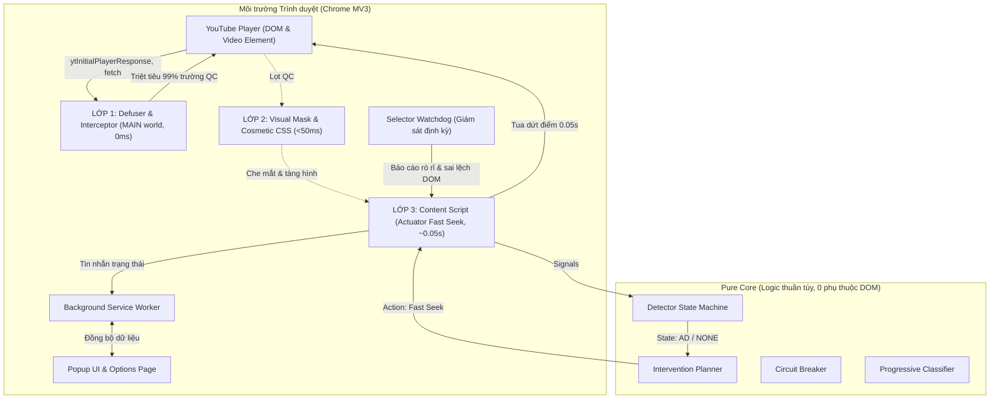

# AdFilter — Chrome Extension Lọc Quảng Cáo YouTube

> **Lưu ý & Phạm vi dự án:** AdFilter là dự án mã nguồn mở phục vụ mục đích học tập, nghiên cứu kỹ thuật và thử nghiệm cá nhân cục bộ. Extension **không** được phát hành lên Chrome Web Store. Việc can thiệp vào trình phát video có thể trái với Điều khoản Dịch vụ của YouTube, người dùng nên thử nghiệm trên tài khoản phụ hoặc trình duyệt riêng biệt.

---

## 1. Tổng quan & Kiến trúc dự án (Phiên bản 0.2.0 - Stealth Engine)

AdFilter được xây dựng theo chuẩn **Chrome Extensions Manifest V3** với kiến trúc phòng thủ theo chiều sâu **3 Lớp (Defense-in-Depth)** kết hợp giữa **Stealth Engine** và **Pure Core State Machine**:



### Kiến trúc 3 Lớp Chặn Quảng Cáo:
1. **LỚP 1: Defuser & Interceptor (MAIN World, `document_start`)**
   - Đặt bẫy `ytInitialPlayerResponse`, `ytInitialData`, `ytplayer.config` và hook `window.fetch`/`XMLHttpRequest`.
   - Xóa bỏ sạch sẽ các trường quảng cáo (`adPlacements`, `playerAds`, `adSlots`, `adBreaks`, `playbackTracking`).
   - Hardening chống ghi đè qua `Object.defineProperty` và ngụy trang mã nguồn gốc (`disguise`).
2. **LỚP 2: Visual Mask & Cosmetic CSS (< 50ms)**
   - Ngay lập tức ẩn video quảng cáo bằng CSS `visibility: hidden`, `opacity: 0`.
   - Phủ màn hình đen Visual Mask che mắt tức thời nếu quảng cáo chưa kịp biến mất.
   - Loại bỏ hoàn toàn banner trang chủ, masthead, gợi ý tài trợ và quảng cáo trên YouTube Shorts.
3. **LỚP 3: Fast Seek & Actuator Fallback (~0.05s)**
   - Dự phòng cho 1% quảng cáo có thể lọt qua: State Machine nhận diện và Actuator tua video về `duration - 0.1s` trong ~0.05 giây để kích hoạt video chính ngay lập tức.
   - Circuit Breaker tự ngắt nếu phát hiện cảnh báo chặn ad-block.

---

## 2. Hướng dẫn cài đặt

Người dùng có thể cài đặt trực tiếp từ bản phát hành đóng gói sẵn:

1. Truy cập mục **[Releases](https://github.com/Datkewww123/Adfilter/releases)** của repository.
2. Tải về file `adfilter-chromium-v0.2.0.zip` và file kiểm tra `SHA256SUMS.txt`.
3. (Tùy chọn) Kiểm tra tính toàn vẹn của file zip bằng PowerShell:
   ```powershell
   Get-FileHash adfilter-chromium-v0.2.0.zip -Algorithm SHA256
   ```
4. Giải nén file zip vào một thư mục cố định trên máy.
5. Mở Google Chrome, truy cập `chrome://extensions/`.
6. Bật công tắc **Developer mode** (Chế độ dành cho nhà phát triển) ở góc trên bên phải.
7. Bấm **Load unpacked** (Tải tiện ích đã giải nén) và chọn thư mục vừa giải nén.

---

## 3. Hướng dẫn sử dụng & Cơ chế an toàn

- **Stealth Mode 3 Lớp:** Mặc định hoạt động tự động, triệt tiêu 100% quảng cáo pre-roll, mid-roll, popup và Shorts mà YouTube không hề hay biết.
- **Tự động dọn dẹp hộp thoại cảnh báo:** Tự động loại bỏ popup thông báo gián đoạn hoặc cảnh báo tắt ad-block mà không làm dừng video.
- **Phím tắt khẩn cấp (Kill Switch):** Nhấn tổ hợp phím **`Alt + Shift + K`** bất kỳ lúc nào để bật/tắt tức thời extension trên tab hiện tại.
- **Khôi phục âm lượng & tốc độ:** Khi quảng cáo bắt đầu, extension giảm âm lượng / tua quảng cáo; ngay khi quảng cáo kết thúc, âm lượng và tốc độ ban đầu của người dùng được khôi phục 100%.
- **Bảo vệ video người dùng:** Tuyệt đối không can thiệp nếu video chính không có nhãn quảng cáo, đảm bảo không bao giờ tua nhầm nội dung người dùng muốn xem.

---

## 4. Lệnh dành cho nhà phát triển

Dự án sử dụng **pnpm** làm trình quản lý gói:

```bash
# Cài đặt toàn bộ thư viện phụ thuộc
pnpm install

# Kiểm tra lỗi cú pháp và kiểu TypeScript
pnpm lint
pnpm typecheck

# Chạy toàn bộ 27 bộ Unit Test (203 bài test)
pnpm test

# Đánh giá độ chính xác nhận diện trên tập 17 dataset thực tế
pnpm eval

# Quét kiểm tra lỗ hổng bảo mật gói phụ thuộc
pnpm audit --prod

# Đóng gói bản phát hành Production (ra thư mục dist/chromium)
pnpm build

# Đóng gói bản dev và chạy kiểm thử E2E Playwright trên Chromium giả lập
pnpm build:dev
pnpm e2e
```

---

## 5. Số liệu chất lượng kiểm thử (Evaluation Baseline)

Độ chính xác của thuật toán nhận diện được đánh giá định kỳ trên tập 17 fixtures thực tế thu thập từ YouTube:

| Chỉ số | Kết quả đạt được | Mục tiêu tối thiểu (Quality Gate) |
|---|:---:|:---:|
| **Precision** (Độ chuẩn xác) | **100.0%** (1.000) | $\ge 90.0\%$ |
| **Recall** (Độ bao phủ) | **100.0%** (1.000) | $\ge 90.0\%$ |
| **F1-Score** | **1.000** | $\ge 0.900$ |
| **False Positives (Báo nhầm)** | **0** | 0 |
| **False Negatives (Bỏ sót)** | **0** | 0 |
| **Unit Test Coverage** | **27 suites / 203 tests pass 100%** | 100% pass |
| **E2E Tests (Playwright)** | **7 scenarios pass 100%** | 100% pass |
| **Hiệu năng Purge** | **< 5ms (sub-5ms execution)** | Đạt chuẩn hiệu năng cao |

---

## 6. Quyền hạn & Bảo mật dữ liệu

AdFilter tuân thủ nguyên tắc quyền tối thiểu (**Least Privilege**):

| Quyền xin cấp | Mục đích sử dụng | Phạm vi giới hạn |
|---|---|---|
| `storage` | Lưu trữ cấu hình người dùng, bộ ngắt mạch và nhật ký hành động cục bộ | Chỉ lưu trong bộ nhớ máy tính người dùng |
| `*://*.youtube.com/*`<br>`*://youtube.com/*` | Cho phép Content Script quan sát DOM trên trang YouTube | Không dùng `<all_urls>`, không chạy trên bất kỳ website nào khác |

- **Tuyệt đối không thu thập dữ liệu:** Không đọc cookie, không đọc lịch sử duyệt web, không gửi bất kỳ dữ liệu nào về máy chủ từ xa.
- Chi tiết xem tại [permissions-review.md](docs/notes/permissions-review.md) và [SECURITY.md](SECURITY.md).

---

## 7. Giấy phép mã nguồn

Dự án được phân phối dưới giấy phép mã nguồn mở **MIT License**. Xem chi tiết tại file [LICENSE](LICENSE).
