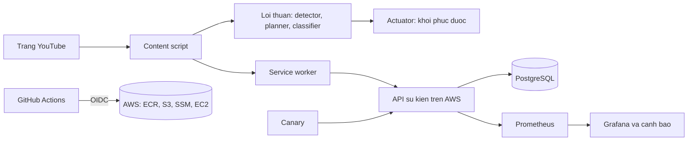

# Tài liệu Kiến trúc Hệ thống (System Architecture)

## 1. Sơ đồ Tổng quan Hệ thống

---

## 2. Phạm vi & Giới hạn Trung thực (Scope & Honest Limitations)

- **Mục đích kỹ thuật:** AdFilter là một dự án kỹ thuật toàn diện (End-to-End Engineering Project) được thiết kế cho **một người dùng cá nhân** nhằm rèn luyện kiến trúc phần mềm sạch (Functional Core, Imperative Shell), kiểm thử tự động đa tầng, quan sát hệ thống (Observability) và hạ tầng đám mây dưới dạng mã (Terraform IaC & Zero-SSH CD).
- **Ràng buộc pháp lý & Điều khoản dịch vụ:** Việc can thiệp vào trình phát của YouTube có thể trái với Điều khoản Dịch vụ (ToS) của nền tảng. Do đó, tiện ích **tuyệt đối không được phát hành lên Chrome Web Store hay Mozilla Add-ons**, chỉ chạy cục bộ trên tài khoản/profile thử nghiệm cá nhân.
- **Kích thước mẫu đo lường:** Bộ dữ liệu đánh giá (17 fixtures thực tế và 53 phiên quảng cáo dogfooding ở Tuần 9) phù hợp cho phạm vi kiểm chứng kỹ thuật cá nhân, chưa đại diện cho toàn bộ biến thể quảng cáo theo vùng địa lý hay A/B testing toàn cầu của YouTube.

---

## 3. Ranh giới Tin cậy & Bảo mật (Trust Boundaries)

Hệ thống phân chia thành **4 vùng tin cậy (Trust Zones)** rõ rệt:

1. **Vùng Không Tin Cậy (Untrusted Web Page — DOM & MAIN World):**
   - Trang YouTube có thể thay đổi cấu trúc DOM bất kỳ lúc nào hoặc kiểm tra sự hiện diện của tiện ích.
   - Mọi dữ liệu đọc từ DOM được trích xuất thành cấu trúc dữ liệu phẳng `Signals` đã được chuẩn hóa kiểu trước khi đưa vào lõi xử lý.
2. **Vùng Tiện Ích Đặc Quyền Tối Thiểu (Extension Sandbox — Manifest V3):**
   - Chỉ xin quyền duy nhất `storage` và `host_permissions` giới hạn chặt trên `*.youtube.com` (được kiểm soát tự động bằng bài test chống phình quyền [`tests/unit/manifest.test.ts`](../tests/unit/manifest.test.ts)).
   - Tuyệt đối không dùng `<all_urls>`, `tabs`, `webRequest` hay `cookies`.
3. **Vùng Truyền tải Telemetry Tùy Chọn (Opt-in & Whitelisted Telemetry Boundary):**
   - Mặc định tính năng gửi số liệu bị **tắt (`telemetryEnabled = false`)**.
   - Ngay cả khi bật, [`src/core/telemetry.ts`](../src/core/telemetry.ts) và schema Zod trên Server ([`server/src/schema.ts`](../server/src/schema.ts)) chỉ chấp nhận danh sách trắng (whitelist) các trường số học và enum trạng thái; tuyệt đối không bao giờ đọc hay gửi URL, video ID, tiêu đề video hay định danh người dùng.
4. **Vùng Hạ tầng Đám mây Đóng Cổng (Zero-Inbound Cloud Boundary):**
   - Máy chủ EC2 nằm trong Security Group **không mở bất kỳ cổng chiều vào nào** từ Internet (kể cả cổng 22 SSH hay cổng 3000 API).
   - Mọi truy cập từ máy cá nhân vào API (`localhost:3000`) và Grafana (`localhost:3001`) đều đi qua đường hầm mã hóa **AWS SSM Port Forwarding** được xác thực bằng IAM.
   - GitHub Actions xác thực với AWS bằng **OIDC ngắn hạn**, không lưu trữ bất kỳ khóa truy cập dài hạn nào.

---

## 4. Luồng Dữ liệu Chi tiết (End-to-End Data Flow)

1. **Tầng Chặn Sớm (Stealth Layer — `document_start`):**
   - [`src/stealth/defuser.ts`](../src/stealth/defuser.ts) và [`src/stealth/interceptor.ts`](../src/stealth/interceptor.ts) lọc bỏ các trường cấu hình quảng cáo (`adPlacements`, `playerAds`, `adSlots`, `adBreaks`) ngay khi dữ liệu JSON của trình phát vừa nạp, đồng thời bảo vệ luồng phát bằng Auto-Resume Guard.
2. **Tầng Quan sát & Trích xuất Tín hiệu (`PlayerObserver` -> `extractSignals`):**
   - [`src/content/observer.ts`](../src/content/observer.ts) theo dõi biến đổi DOM trên `#movie_player` và gọi [`src/core/selectors.ts`](../src/core/selectors.ts) để thu thập đối tượng `Signals` thuần túy.
3. **Tầng Lõi Quyết định Thuần (`Pure Core`):**
   - **Detector ([`src/core/detector.ts`](../src/core/detector.ts)):** Máy trạng thái hữu hạn (FSM) có debounce xác định trạng thái `NONE`, `CANDIDATE`, `AD` hoặc `COOLDOWN`.
   - **Classifier ([`src/core/classifier.ts`](../src/core/classifier.ts)):** Phân loại lũy tiến quảng cáo (`skippable`, `non_skippable`, `bumper`).
   - **Circuit Breaker ([`src/core/circuitBreaker.ts`](../src/core/circuitBreaker.ts)):** Kiểm tra an toàn trước khi cho phép can thiệp; tự động ngắt mạch nếu phát hiện cảnh báo từ trang (`ENFORCEMENT_SEEN`) hoặc thất bại liên tiếp.
   - **Intervention Planner ([`src/core/intervention.ts`](../src/core/intervention.ts)):** Quyết định hành động (`MUTE`, `SPEED`, `CLICK_SKIP`, `SEEK_TO_END`, hoặc `NOOP`).
4. **Tầng Thực thi & Xác minh (`Actuator` & `verifyAction`):**
   - [`src/content/actuator.ts`](../src/content/actuator.ts) lưu trạng thái gốc của người dùng (`noteBaseline`), thực thi hành động can thiệp, kiểm tra kết quả qua [`src/core/verify.ts`](../src/core/verify.ts) và khôi phục nguyên vẹn âm lượng/tốc độ (`restore`) ngay khi quảng cáo kết thúc.
5. **Tầng Quan sát & Cảnh báo (`Service Worker` -> `Fastify API` -> `Prometheus` -> `Grafana`):**
   - Các bản ghi hành động và kết quả kiểm tra cấu trúc từ [`canary/check.ts`](../canary/check.ts) được đẩy về API Server, lưu vào PostgreSQL và xuất metrics tại `/metrics` để Prometheus thu thập và Grafana phát cảnh báo tự động.

---

## 5. Các Đánh đổi Kỹ thuật Chính (Key Architectural Trade-offs)

| Quyết định lựa chọn | Lợi ích đạt được | Chi phí / Đánh đổi chấp nhận |
| :--- | :--- | :--- |
| **Tách Lõi Thuần (`src/core/`) không phụ thuộc DOM/Chrome API** ([ADR-0001](decisions/0001-pure-core.md)) | Chạy 253 bài unit test trong vài giây không cần trình duyệt; đánh giá Precision/Recall offline trên tập fixtures. | Cần thêm lớp chuyển đổi `extractSignals` và `Actuator` ở rìa. |
| **Hạ cấp an toàn bằng Circuit Breaker thay vì cố vượt cảnh báo** ([ADR-0003](decisions/0003-circuit-breaker-and-safe-degradation.md)) | Bảo vệ trải nghiệm xem video và tài khoản của người dùng, không bao giờ làm kẹt trình phát. | Chấp nhận để một số quảng cáo trôi qua khi bộ ngắt mạch đang mở. |
| **Đóng toàn bộ cổng vào trên EC2, chỉ dùng AWS SSM** ([ADR-0005](decisions/0005-ssm-not-ssh.md)) | Loại bỏ 100% bề mặt tấn công mạng từ Internet (không sợ lộ SSH key hay lỗ hổng RCE trên cổng public). | Khi gửi telemetry từ máy cá nhân cần bật phiên SSM Port Forwarding. |
| **Giải nén theo thư mục phát hành `releases/<TAG>`** ([ADR-0007](decisions/0007-release-directories.md)) | Quay lui nguyên tử (Atomic Rollback) cả Docker image lẫn file cấu hình `docker-compose.prod.yml` khi `/health` lỗi. | Tốn thêm một lượng nhỏ dung lượng đĩa để lưu 5 bản phát hành gần nhất. |
